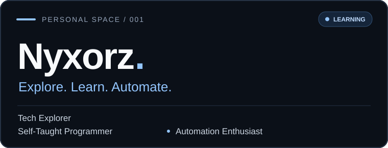
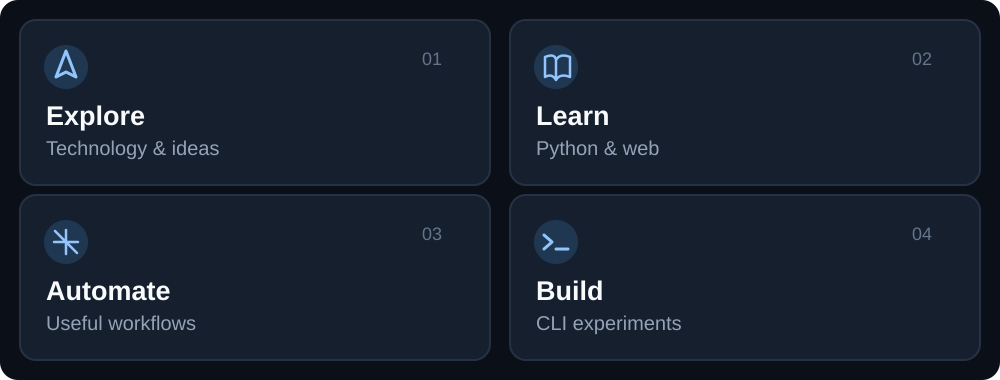

 

### 01 / About

I'm **Nyxorz**, a self-taught programming learner exploring technology through code, small experiments, and practical automation.

### 02 / What I'm exploring

  

### 03 / Mindset

> **Build to learn. Learn to build.**  
> Small steps, steady progress.

---

  Stay curious · Keep building

